> [!TIP]
> 🚧 **项目重构中**：本项目正从 Tauri 迁移至基于 C/C++、SDL3 和 OpenGL 的原生实现。由于项目刚完成维护交接，重构期间暂不受理 Bug 报告及 PR。重要事项请联系[当前维护者](https://github.com/vladelaina)。
>
> 🚧 **Project Rewrite in Progress:** This project is being migrated from Tauri to a native implementation based on C/C++, SDL3, and OpenGL. As the project has recently undergone a maintainer transition, bug reports and PRs are temporarily not being accepted during the rewrite. For important matters, please contact the [current maintainer](https://github.com/vladelaina).

  

    
    
    
  

  

    
    
    
  

  

    
    
    <a href="https://hellogithub.com/repository/7d23863fd4be47b39e816193ded385c9" target="_blank">
      <picture>
        <source media="(prefers-color-scheme: dark)" srcset="https://abroad.hellogithub.com/v1/widgets/recommend.svg?rid=7d23863fd4be47b39e816193ded385c9&claim_uid=5ihRVIuTYBmSGtQ&theme=dark" />
        <source media="(prefers-color-scheme: light)" srcset="https://abroad.hellogithub.com/v1/widgets/recommend.svg?rid=7d23863fd4be47b39e816193ded385c9&claim_uid=5ihRVIuTYBmSGtQ&theme=neutral" />
        
      </picture>
    </a>
  

| macOS                                                                                        | Windows                                                                                        | Linux(x11)                                                                                   |
| -------------------------------------------------------------------------------------------- | ---------------------------------------------------------------------------------------------- | -------------------------------------------------------------------------------------------- |
|  |  |  |

## Project Status

## 赞助商

## 开发背景

本项目的灵感来源于 [MMmmmoko](https://github.com/MMmmmoko) 大佬开发的 [Bongo-Cat-Mver](https://github.com/MMmmmoko/Bongo-Cat-Mver)。它以独特的猫咪互动功能深受用户喜爱，但仅支持 Windows 平台。作为一名深度 macOS 用户，我特别希望在自己的设备上也能使用这款可爱的猫咪，于是我决定开发一个适配 macOS 的版本。

当前原生版本基于 C/C++、SDL3 和 OpenGL 构建，支持 macOS、Windows 和 Linux(x11)，让更多用户都能与这只可爱的猫咪互动！

## 技术架构

```mermaid
%%{init: {"flowchart": {"curve": "catmullRom", "htmlLabels": true, "nodeSpacing": 24, "rankSpacing": 38}}}%%
flowchart TB
  User(["用户输入<br/>Keyboard · Mouse · Gamepad"])
  ModelSources(["模型来源<br/>Builtin · Mver · Custom · Nearby"])
  Desktop(["桌面输出<br/>透明宠物窗口 · 偏好设置"])

  subgraph Platform["平台后端"]
    direction LR
    Win["Windows<br/>Win32 · Layered Window · Capture"]
    Mac["macOS<br/>Cocoa · ApplicationServices"]
    Linux["Linux<br/>X11 · XInput2 · XFixes"]
  end

  subgraph Native["BongoCat Native Runtime"]
    direction TB

    subgraph Orchestration["运行时编排 · C11"]
      direction LR
      Entry["程序入口<br/>src/main.c"]
      Lifecycle["生命周期<br/>startup · storage · config · shutdown"]
      EventLoop["SDL3 事件 / 帧调度器<br/>wait → drain → update → render"]
      AppState[("BongoCatApp<br/>settings · session · catalogs · runtime state")]

      Entry --> Lifecycle --> EventLoop
      Lifecycle <--> AppState
      EventLoop <--> AppState
    end

    subgraph InputShell["输入与桌面外壳"]
      direction LR
      NativeHooks["原生输入钩子<br/>keyboard · mouse · gamepad"]
      InputQueue[("原子输入队列<br/>timestamp · ordering · recovery")]
      InputMap["输入映射<br/>shortcuts · mouse · gamepad"]
      Shell["窗口 / 托盘 / 菜单<br/>drag · scale · click-through · multi-pet"]

      NativeHooks --> InputQueue --> InputMap
      Shell --> EventLoop
      EventLoop --> InputMap
      InputMap --> AppState
    end

    subgraph ModelPipeline["模型发现、适配与存储"]
      direction LR
      Discover["发现与格式识别<br/>builtin · Mver · custom · patch"]
      Validate["安全校验与身份计算<br/>manifest · path · digest · metadata"]
      Adapt["运行时适配器生成<br/>package · input assets · projection"]
      Store[("按用户隔离的存储<br/>data/models · cache/adapters")]
      Catalog["模型 / 行为目录<br/>refresh · motions · expressions · effects"]

      Discover --> Validate --> Adapt --> Store --> Catalog
      Catalog --> AppState
    end

    subgraph Presentation["动画、渲染与 UI"]
      direction LR
      Live2DBridge["C ABI / C++17 Bridge"]
      Cubism["Live2D Cubism Runtime<br/>model · motion · expression · physics · pose"]
      Media["媒体服务<br/>images · textures · audio"]
      Composite["OpenGL 合成管线<br/>background → model → keys / effects / pointer"]
      Preferences["Nuklear 偏好设置<br/>Catime theme · i18n · model management"]
      Present["平台呈现<br/>layered window / OpenGL swap"]

      Live2DBridge --> Cubism --> Composite --> Present
      Media --> Cubism
      Media --> Composite
      AppState <--> Preferences
    end

    EventLoop --> Live2DBridge
    EventLoop --> Composite
    EventLoop --> Preferences
    AppState --> Live2DBridge
    AppState --> Composite
    InputMap --> Live2DBridge
    InputMap --> Composite
    Catalog --> Live2DBridge
    Shell --> Preferences
  end

  subgraph Dependencies["原生依赖"]
    direction LR
    SDL["SDL3"]
    OpenGL["OpenGL / GLEW"]
    CubismSDK["Live2D Cubism SDK"]
    YYJSON["yyjson"]
    STB["stb"]
    Miniaudio["miniaudio"]
    Nuklear["Nuklear"]
  end

  subgraph Toolchain["构建、验证与发布"]
    direction LR
    CMake["CMake<br/>dependencies · platform · assets"]
    CTest["CTest<br/>core · i18n · UI · import · Live2D · capture"]
    Audits["Runtime Audits<br/>smoke · visual · safety · source policy"]
    Packaging["Distribution<br/>portable · NSIS · MSIX"]

    CMake --> CTest
    CMake --> Audits
    CMake --> Packaging
  end

  User --> NativeHooks
  User --> Shell
  ModelSources --> Discover

  Win --> NativeHooks
  Mac --> NativeHooks
  Linux --> NativeHooks
  Win --> Shell
  Mac --> Shell
  Linux --> Shell
  Win --> Present
  Mac --> Present
  Linux --> Present

  Present --> Desktop
  Preferences --> Desktop

  SDL -.-> EventLoop
  SDL -.-> Shell
  OpenGL -.-> Composite
  CubismSDK -.-> Cubism
  YYJSON -.-> Lifecycle
  YYJSON -.-> Validate
  STB -.-> Media
  Miniaudio -.-> Media
  Nuklear -.-> Preferences

  CMake -.-> Entry
  CTest -.-> EventLoop
  Audits -.-> Composite

  classDef external fill:#fff4cc,stroke:#b7791f,color:#3d2b00,stroke-width:1.5px
  classDef platform fill:#e8f1ff,stroke:#4a78b8,color:#14263d,stroke-width:1.5px
  classDef runtime fill:#ffe8f0,stroke:#d95f8d,color:#3d1725,stroke-width:1.5px
  classDef state fill:#f3eaff,stroke:#8a63c7,color:#2c1b46,stroke-width:1.5px
  classDef input fill:#e7f8ff,stroke:#3f8eaa,color:#12323d,stroke-width:1.5px
  classDef model fill:#eaf8e8,stroke:#57945a,color:#18361a,stroke-width:1.5px
  classDef render fill:#f3ecff,stroke:#8064b3,color:#281b40,stroke-width:1.5px
  classDef dependency fill:#f4f4f5,stroke:#71717a,color:#27272a,stroke-width:1.2px
  classDef tooling fill:#fff0dd,stroke:#c47b2c,color:#42270d,stroke-width:1.5px

  class User,ModelSources,Desktop external
  class Win,Mac,Linux platform
  class Entry,Lifecycle,EventLoop runtime
  class AppState,InputQueue,Store state
  class NativeHooks,InputMap,Shell input
  class Discover,Validate,Adapt,Catalog model
  class Live2DBridge,Cubism,Media,Composite,Preferences,Present render
  class SDL,OpenGL,CubismSDK,YYJSON,STB,Miniaudio,Nuklear dependency
  class CMake,CTest,Audits,Packaging tooling

  style Native fill:#fffafd,stroke:#d95f8d,stroke-width:2px
  style Platform fill:#f8fbff,stroke:#7da1cf,stroke-width:1.5px
  style Orchestration fill:#fff7fa,stroke:#ed9eb8,stroke-width:1px
  style InputShell fill:#f5fcff,stroke:#86bfd3,stroke-width:1px
  style ModelPipeline fill:#f7fcf5,stroke:#91bd8f,stroke-width:1px
  style Presentation fill:#faf7ff,stroke:#ad98cf,stroke-width:1px
  style Dependencies fill:#fafafa,stroke:#a1a1aa,stroke-width:1px
  style Toolchain fill:#fffaf3,stroke:#dda866,stroke-width:1.5px
```

## 下载

- [夸克网盘](https://pan.quark.cn/s/70f2f2663ce1)
- [GitHub Releases](https://github.com/ayangweb/BongoCat/releases)

不确定下载哪一个？请查阅[下载指南](.github/DOWNLOAD_GUIDE.md)。

## 更多模型

你可以在这个仓库中探索、下载更多猫咪模型，或提交你的创作，与大家一起分享：

📦 [Awesome-BongoCat](https://github.com/ayangweb/Awesome-BongoCat)

## 社区交流

<table>
  <thead>
    <tr>
      <th>QQ 群 1</th>
      <th>QQ 群 2</th>
    </tr>
  </thead>
  <tbody>
    <tr>
      <td>
        <a href="https://qm.qq.com/q/AS3gNv2Vzy">
          <picture>
            <source
              media="(prefers-color-scheme: dark)"
              srcset="https://i0.hdslb.com/bfs/openplatform/8ecdc4982ab01b59d7731fcca3ec26631a274560.png"
            />
            <source
              media="(prefers-color-scheme: light)"
              srcset="https://i0.hdslb.com/bfs/openplatform/09f56580397063e1819c4c2ed63d07dee12720e1.png"
            />
            
          </picture>
        </a>
      </td>
      <td>
        <a href="https://qm.qq.com/q/TmltLAod2O">
          <picture>
            <source
              media="(prefers-color-scheme: dark)"
              srcset="https://i0.hdslb.com/bfs/openplatform/473c522487ff33e0f32b15466aeb0734f17161c8.png"
            />
            <source
              media="(prefers-color-scheme: light)"
              srcset="https://i0.hdslb.com/bfs/openplatform/d5ae8c5af6ae1d0a1f066705ee822d1287384cf6.png"
            />
            
          </picture>
        </a>
      </td>
    </tr>
  </tbody>
</table>

## 赞赏

每一份认可都值得被珍视！赞赏随缘，心意无价，谢谢你的支持 ❤️

<picture>
  <source media="(prefers-color-scheme: dark)" srcset="https://i0.hdslb.com/bfs/openplatform/e7438bff14cdfb6bfd0feacbb482f99ea4093294.png" />
  <source media="(prefers-color-scheme: light)" srcset="https://i0.hdslb.com/bfs/openplatform/da55cc3ec1556580c91e59f589792866c998c7c6.png" />
  
</picture>

## Special Thanks❤️

## Star History

<a href="https://www.star-history.com/#ayangweb/BongoCat&Date">
 <picture>
   <source media="(prefers-color-scheme: dark)" srcset="https://api.star-history.com/svg?repos=ayangweb/BongoCat&type=Date&theme=dark" />
   <source media="(prefers-color-scheme: light)" srcset="https://api.star-history.com/svg?repos=ayangweb/BongoCat&type=Date" />
   
 </picture>
</a>

---

Copyright © 2025-2026 - **BongoCatPet**\
Made with ❤️ & ⌨️

